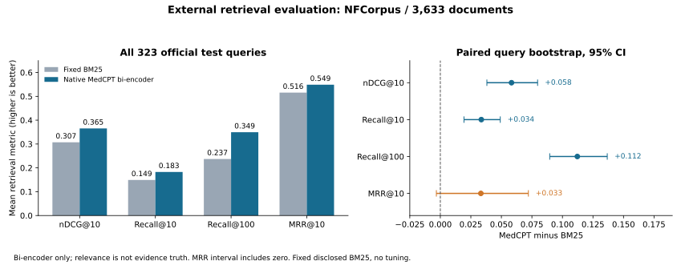
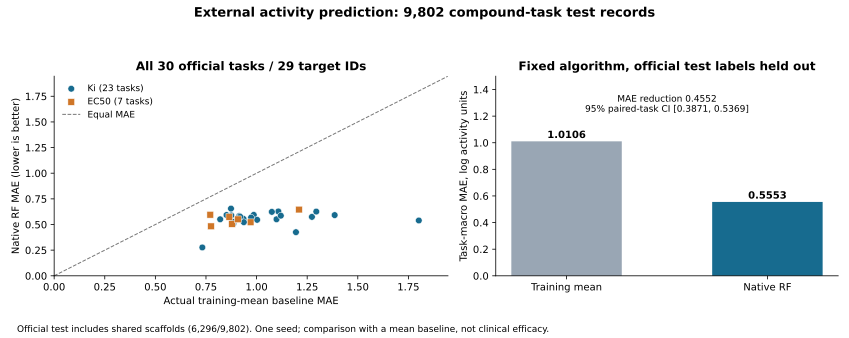

# EVIDA — 근거에서 다음 연구 행동으로

**[EVIDA 실행](https://evida.ndagentevida.com)** · **[사용 방법과 예시 질문](docs/DEMO_HOW_TO_RUN.md)** · **[성능 지표와 평가 기준](evaluation/README.md)**

EVIDA는 **질환과 연구 목표에서 출발해, 근거와 관측을 다음 연구 판단으로 연결하는 신약개발 연구 플랫폼**입니다. 기전과 개입 방향을 비교하고 후보를 찾은 뒤, 무엇을 무엇과 비교하고 어떤 값을 읽을지 구체적인 다음 실험으로 연결합니다. 연구자가 새 결과나 조건을 추가하면 앞선 판단과 판단이 달라진 이유를 함께 보존합니다.

## 여섯 질환의 연구 목표에서 시작하기

| 연구 | 출발 질문 | 바로 열기 |
|---|---|---|
| 뇌전증 | 기전·표적·저분자 후보 찾기 | [뇌전증 연구](https://evida.ndagentevida.com/?workspace=ws_d575a20bbf9047d2) |
| COPD | 치료 기전·후보와 다음 실험 | [COPD 연구](https://evida.ndagentevida.com/?workspace=ws_ff8a3fd859984073) |
| ATTR-CM | 진행을 줄일 전략·후보와 다음 실험 | [ATTR-CM 연구](https://evida.ndagentevida.com/?workspace=ws_b8cdca2ed22641ab) |
| 파킨슨병 | 진행을 늦출 기전·치료 후보 | [파킨슨병 연구](https://evida.ndagentevida.com/?workspace=ws_62adbaf10b8249d3) |
| 비소세포폐암 | 치료 기전·저분자 후보와 다음 실험 | [폐암 연구](https://evida.ndagentevida.com/?workspace=ws_4c375887117542a8) |
| MASH | 개선할 기전·후보와 다음 실험 | [MASH 연구](https://evida.ndagentevida.com/?workspace=ws_47f9067e7c434890) |

입력은 질환과 목표를 담고 있습니다. 조사할 표적·약물·계산 도구는 오케스트레이터가 근거를 살펴 선택합니다. 각 연구에서 실제 수행 기록과 게시된 판단, 다음 확인 사항을 열어봅니다. 게시한 조건부 판단과 원래 연구 목표의 남은 연결을 함께 확인하며, 필요한 내부 조사와 연구자 입력을 구분해 이어갑니다. 기존 IPF·PDE4B·ALS를 포함한 저장 연구도 연구 목록에 보존합니다.

연구 화면의 탭 **한눈에 보기 · 목표 · 기전 · 후보 · 실험 · 결과 반영 · 근거**를 차례로 열어 확인합니다. 다른 저장 연구는 왼쪽 **연구 목록**에서 엽니다. 기전 상세의 **이 기전 검토하기**에서 탐색 방향을 고르고 이유를 적은 뒤 실제 검토를 시작할 수 있습니다. 저장된 판단에 대한 설명 질문과 새 관측·조건 입력은 따로 제공합니다.

공개 서비스는 새 요청을 **대회 API(GPT-6 Sol · medium)**로 실행합니다. 대회 API가 토큰 사용량 한도(HTTP 403)를 반환하면 안내창이 열리고, 방문자가 **제출자 구독 모델(Claude Opus 5 · medium 또는 GPT-6 Sol · medium)**을 직접 골라 다시 실행할 수 있습니다. 구독 모델은 제출자(연구자) 개인 구독으로 운용되며, 고를 때 주의 확인을 거칩니다. 모델은 자동으로 바뀌지 않습니다. 새 연구와 여섯 시연 연구의 계획은 목표를 따라 이어지며, 실행 경로별 자원 예산은 모델 이용 안내에 표시됩니다. 연결 상태는 화면 위의 **모델 이용 안내**에서 확인합니다.

## 하나의 추론 코어와 실제 도구

원500개 선정 출처의 논증과 처분을 정리하고, 적용 조건을 가진 **48개 추론 원리**로 연결했습니다. 원래500개 중 현재 근거493개, 철회 이력을 둔 역사 사례1개, 범위 밖6개의 처분과 출처를 보존합니다. 주 오케스트레이터는 조사·계산 선택부터 가설과 실험 설계, 결과 반영까지 같은 원리를 활용합니다. [코어의 구축 과정과 원문 연결](docs/REASONING_CORE.md)에서 추출·통합·검수 범위를 확인할 수 있습니다.

제품에는 **43종 계산·분석 함수**와 문헌·웹·API 조회 경로가 연결돼 있습니다. 분자 물성·활성·구조·동역학·역합성·RNA 등 현재 질문을 구별하는 데 필요한 계산을 선택하고, 입력·단위·조건·원출력을 함께 기록합니다. [도구별 역할과 실행 근거](docs/COMPUTATION_TOOLS.md), [입력에서 다음 판단까지](docs/ARCHITECTURE.md)를 참고하세요.

핵심 판단은 화면 앞에, 상세 근거와 원 계산값은 펼쳐보기에 배치했습니다. 분자 구조·출처·계산값을 같은 후보에서 확인하고, 연구자가 결과를 넣으면 이전 판단과 후속 판단을 함께 살펴봅니다.

## 구성과 실행 환경

이 저장소는 공개 제품의 **검토 가능한 소스와 평가 자료**를 담고 있습니다. 실제 동작은 위 데모와 예시 질문으로 확인합니다.

| 경로 | 내용 |
|---|---|
| `evida/` | 연구 기록, 도구 실행, 출처·참조 검사, 과학 계산, HTTP 서비스 |
| `web/` | 화면 소스와 번들, 구조 뷰어·폰트와 라이선스 |
| `configs/` | 연구 지시, 공개 예시, 과학 패키지 목록과 배포 자원 템플릿 |
| `runtime/` | 제출자 구독 경로(Claude·ChatGPT) 연결과 응답 형식 검증 소스 |
| `evaluation/` | 연구 흐름 16회 비교, 공개 검색·활성 예측 평가, 저장 출력과 재검산 코드 |
| `docs/` | 사용 방법, 제품 구조, 방법 채택 범위 |

과학 계산 환경은 **Python 3.12와 RDKit 등 고정 패키지**, 도구별 공개 자원·모델을 사용합니다. 버전과 연결 조건은 `configs/science-packages.lock.txt`와 자원 템플릿에 있습니다. 구독 경로를 실행하려면 검수된 LROS 기반 adapter, Claude·Codex CLI와 각 구독 인증, 운영자의 검토 프로필이 필요합니다. 상세 의존성은 [런타임 안내](runtime/README.md)에 정리했습니다. 운영 DB, 사용자 입력, 모델 원응답, 인증 정보와 가중치는 운영 환경에서 따로 관리합니다.

테스트 코드와 승인된 synthetic service 입력을 함께 제공합니다. 추가 연구 snapshot을 사용하는 검사는 해당 fixture와 고정 환경을 별도로 준비한 조건에서 실행합니다.

제3자 코드와 글꼴은 해당 구성요소의 라이선스를 따릅니다. 글꼴은 [Pretendard OFL](web/fonts/OFL-Pretendard.txt), 배포 코드의 고지는 각 vendor 디렉터리에서 확인합니다.

[제품 구조](docs/ARCHITECTURE.md) · [제품 구성과 완료한 시험](docs/METHODS.md)

## 공개 데이터로 확장한 부품 평가

| 부품 · 비교 대상 | 평가 규모 | 결과 |
|---|---|---|
| MedCPT 의미 검색 / 고정 BM25 | NFCorpus 공식 질문 323개 · 문헌 3,633개 | nDCG@10 **0.3072 → 0.3655**, Recall@100 **23.72% → 34.94%** |
| 제품의 RF 활성 예측 / 학습 평균 기준 | MoleculeACE 30과제 · 표적 ID 29개 · 평가 기록 9,802건 | 과제 평균 MAE **1.0106 → 0.5553**, 평균 Spearman **0.7582** |

같은 자료와 사전에 고정한 조건에서 평가했습니다. 검색 평가는 관련 문헌을 찾는 능력을, 활성 평가는 공개 활성값의 예측 오차를 잽니다. 공식 분할·전체 과제·신뢰구간과 원 순위·예측을 보존했고, [확대 평가의 조건·전체 결과·재검산 코드](evaluation/components-20261002/README.md)를 공개합니다.

[CReM 생성 평가](evaluation/crem-generation-20261002/README.md)는 공개 10과제의 실행 상태와, 완료된 5과제에서 실제로 반환된 구조 300건을 제공합니다. 반환 구조 300건 모두의 유효성과 출발 화합물·변환 연결을 검수했고, 원 구조·공식 출처·재계산 코드를 함께 보존했습니다.

연구 흐름·생성·추가 질환의 비교 조건과 전체 실행 기록은 [평가 자료 모음](evaluation/README.md)에 정리했습니다. 각 실험의 모델·분모·판본과 원 결과를 함께 확인할 수 있습니다.
