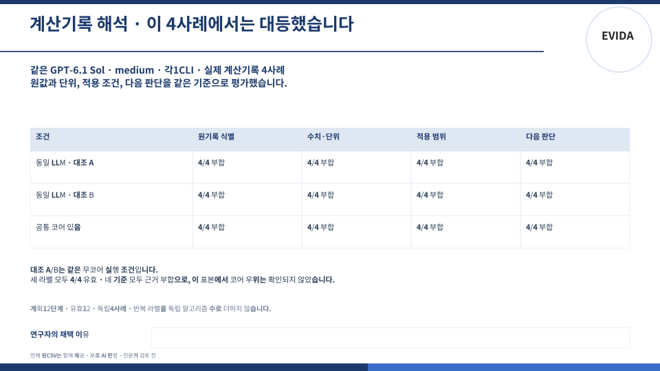
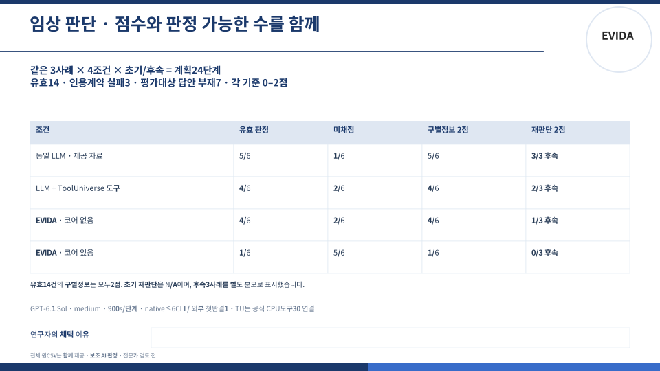
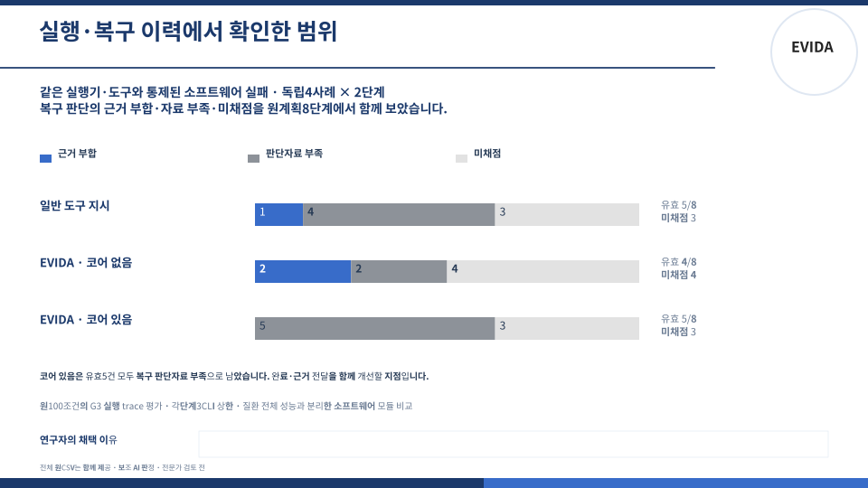
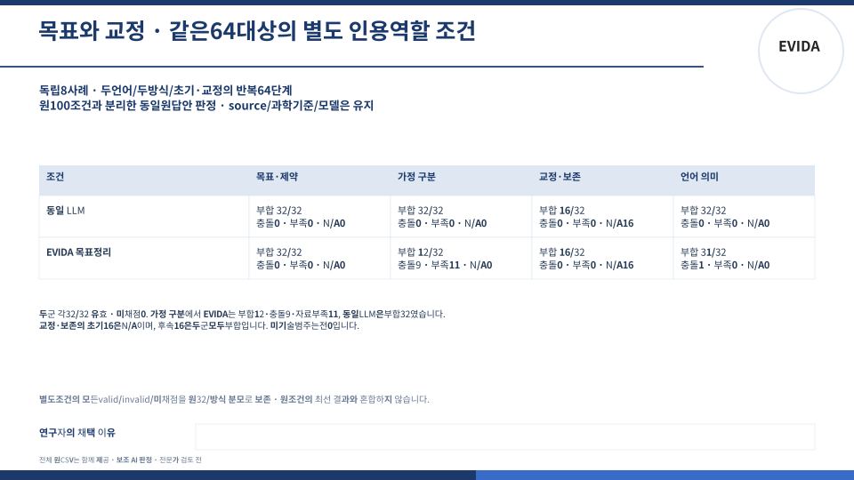

# 연구 구성요소별 비교 기록

사전에 동결한 제품 구성에서 GPT-6.1 Sol · medium으로 목표 구조화, 계산 기록 해석, 도구 실행과 복구, 임상 가설·실험 판단을 비교했습니다. 각 표는 원래 시작한 수를 분모로 유지하며, 점수와 채점 가능한 출력의 수를 함께 제공합니다. 채점은 고정된 기준과 LLM 판정으로 수행했습니다.

## 비교 대상과 독립 사례

| 묶음 | 비교 대상 | 독립 사례와 단계 |
|---|---|---|
| G1 목표·교정 | 같은 LLM / EVIDA 목표 구조화 | 8사례 × 2언어 × 초기·교정 × 2방식 = 64단계 |
| G2 계산 기록 | 같은 실행 경로의 기본 LLM A·B / 공통 코어 사용 | 4사례 × 3표시군 = 12단계 |
| G3 실행·복구 | 일반 도구 지시 / EVIDA 코어 없음·있음 | 4사례 × 초기·후속 × 3방식 = 24단계 |
| 임상 판단 | 같은 LLM / 같은 LLM+ToolUniverse 도구 / EVIDA 코어 없음·있음 | 3사례 × 초기·후속 × 4방식 = 24단계 |

G2의 A·B는 동일한 과제·스키마·설정으로 실행한 두 대조 기록입니다. G3의 일반 도구 지시도 같은 Runner를 사용합니다. ToolUniverse 조건은 공식 CPU 도구를 같은 LLM에 연결한 구성입니다. 각 언어와 후속 단계는 같은 원사례에 속합니다.

## 계산 기록 해석

기록 식별, 수치·단위, 적용 범위, 다음 판단의 네 기준에서 세 표시군 모두 4/4 부합했습니다. 이 네 사례에서 동일한 결과를 얻었습니다.

## 임상 가설과 실험 판단

원래 24단계 중 17단계에 판정할 출력이 존재했습니다. 인용 역할을 명확히 한 별도 판정에서는 14건이 유효했고, 3건은 인용 형식 검증에 실패했습니다. 원출력 부재 7건을 포함해 전체 분모 24를 유지합니다. 유효 14건의 구별 정보 점수는 모두 2점이었습니다.

| 조건 | 유효 판정 / 전체 | 구별 정보 2점 / 전체 | 후속 재판단 2점 / 후속 3건 |
|---|---:|---:|---:|
| 같은 LLM | 5/6 | 5/6 | 3/3 |
| 같은 LLM + ToolUniverse 도구 | 4/6 | 4/6 | 2/3 |
| EVIDA · 코어 없음 | 4/6 | 4/6 | 1/3 |
| EVIDA · 코어 있음 | 1/6 | 1/6 | 0/3 |

## 도구 실행과 복구

복구 기준의 부합·판정 근거 부족·미채점 수를 방식당 원래 8단계에서 비교했습니다. 실행·선택·다음 행동을 포함한 모든 기준은 CSV에 함께 있습니다.

| 조건 | 부합 | 판정 근거 부족 | 미채점 | 전체 |
|---|---:|---:|---:|---:|
| 일반 도구 지시 | 1 | 4 | 3 | 8 |
| EVIDA · 코어 없음 | 2 | 2 | 4 | 8 |
| EVIDA · 코어 있음 | 0 | 5 | 3 | 8 |

## 목표와 교정

동일한 원답안 64단계 전체를 대상으로 인용 역할을 명료화한 별도 조건에서 판정했습니다. 두 방식 모두 32/32건이 형식 검증을 통과했습니다. 네 기준의 전체 결과는 다음과 같습니다.

| 기준 | 같은 LLM | EVIDA 목표 구조화 |
|---|---|---|
| 목표·제약 | 부합 32 | 부합 32 |
| 가정 구분 | 부합 32 | 부합 12 · 충돌 9 · 자료 부족 11 |
| 교정·보존 | 부합 16 · 초기 단계 N/A 16 | 부합 16 · 초기 단계 N/A 16 |
| 언어 의미 | 부합 32 | 부합 31 · 충돌 1 |

## 조건과 원기록

G1·G2·G3의 원조건 100단계는 유효 64, 무효·미채점 28, 미호출 3, 원출력 부재 5로 보존했습니다. G1의 별도 64단계 판정과 임상 별도 판정은 각각 별도 파일로 제공합니다. 조건별 답안이나 점수에서 유리한 결과만 골라 합치지 않습니다. 무효·미채점은 과학 점수 0과 구분합니다.

- [원100 전체 상태](tables/actual-original100-ALL_ORIGINAL100_STATUS_ROWS.csv), [원100 모든 기준](tables/actual-original100-ALL_CRITERION_COUNTS.csv)
- [별도 G1 전체64 상태·기준](tables/G1_271_ALL_STATUS_ROWS.csv)
- [별도 임상 전체24 상태](tables/actual257-ALL_ORIGINAL_STATUS_ROWS.csv), [단계별 모든 점수](tables/actual257-ALL_STAGE_DIMENSIONS.csv), [원사례에 묶인 단계 합계](tables/actual257-POOLED_REPEATED_STAGES.csv)
- [파일 출처와 SHA256](PROVENANCE.json)

연구자 채택 이유: ____________________

문항·답안·모델 응답 본문은 원래 접근 조건에 따라 별도로 보관합니다. 이 공개 묶음에는 점수·상태·분모·집계 그래프를 담았습니다.
