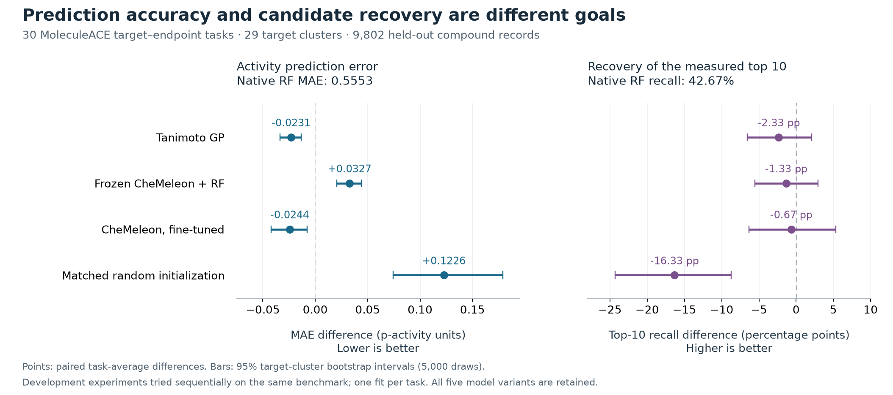

# CheMeleon: frozen representations and task fine-tuning

We tested fine-tuning the official CheMeleon molecular encoder on the same assay training rows used by EVIDA’s RF and Tanimoto GP. A matched randomly initialized network tests whether pretrained initialization helps within the same architecture and training recipe. **All 60 neural task/arm runs completed**, covering **30 MoleculeACE tasks, 29 target clusters and 9,802 test rows per method**.

**Fine-tuned CheMeleon lowered task-average MAE by 4.39% relative to RF, but its advantage over the existing GP was unclear. EVIDA retains its current RF/GP validation policy; the neural method remains an option for a suitable follow-up task.** The expanded four-model policy had almost the same MAE as the original policy. These are activity-prediction measurements, not evidence of better drugs or prospective discovery.

## Why and how

Frozen CheMeleon features with the same RF had already performed worse than Morgan fingerprints. Task fine-tuning tests whether adapting the representation helps. Both neural arms use the author’s depth-six, 2,048-wide message-passing architecture, mean aggregation and a 256-unit regression head. Their initial heads match; only one arm loads the pretrained encoder weights.

All methods use the exact same native inner scaffold training partition. Neural target scaling uses training labels only; validation MSE selects the best checkpoint with patience five and a 50-epoch limit. One seed, batch size 64, float32 and one explicitly assigned GPU are fixed. Validation Spearman and MAE determine eligibility; the lowest unrounded validation MAE selects among eligible methods. Test labels do not select checkpoints or methods. The full 60-arm ledger and independent integrity gate precede final scoring.

## Results

| Task-average metric | Native RF | Tanimoto GP | Frozen CheMeleon + RF | Fine-tuned CheMeleon | Matched random network |
|---|---:|---:|---:|---:|---:|
| MAE ↓ | 0.55532 | 0.53220 | 0.58803 | 0.53095 | 0.67795 |
| RMSE ↓ | 0.74612 | 0.71219 | 0.76833 | 0.70762 | 0.86807 |
| Spearman ↑ | 0.75824 | 0.78270 | 0.75282 | 0.78119 | 0.63802 |
| Measured top-10 recall ↑ | 0.42667 | 0.40333 | 0.41333 | 0.42000 | 0.26333 |
| Best measured p-activity in selected 10 ↑ | 10.02079 | 10.01053 | 10.00048 | 10.04660 | 9.83185 |



The dashed line is RF; all five model variants are represented. Error bars are 29-target-cluster intervals. The random-network-versus-RF contrast in this overview is descriptive post-score analysis; it is not an added primary comparison. [SVG](figures/activity-model-comparison.svg), [PDF](figures/activity-model-comparison.pdf), [source data and hashes](figures/input.json), and [plot script](figures/plot.py) are retained. Plot regeneration additionally requires NumPy and Matplotlib (`3.11.2` in the captured environment); it is optional and not required by offline package verification or score recalculation.

The prespecified fine-tuning primary comparison is task-macro MAE against RF. Fine-tuned CheMeleon minus RF is **−0.02437**, with 95% target-cluster bootstrap interval **[−0.04216, −0.00775]**; 21/30 tasks improve. The relative reduction is computed from the unrounded macro MAEs, not an average of per-task percentage reductions. Against GP, the difference is **−0.00125 [−0.01497, +0.01218]**. Against the matched random network, it is **−0.14700 [−0.19817, −0.10424]**, with 29/30 tasks improving. MAE improvement does not imply improvement on every ranking metric.

The earlier frozen-feature result is retained in full: all 30 fits completed, but MAE was worse than RF on 26 tasks and better on four. The paired difference was **+0.03271 [+0.02058, +0.04385]**. Frozen features did not earn adoption. All original predictions, negative findings, policies and uncertainty intervals remain inspectable in [the frozen-feature results](chemeleon-trial/run-01/scored-results.json).

The neural archive retains **60 planned, 60 completed, zero failed or skipped arms**, both original and amended freezes, the pretraining fixes, original scoring source, [terminal score](chemeleon-finetune-trial/run-01/scored-results.json), [independent pre-score gate](chemeleon-finetune-trial/review-neural-01/actual-pre-score-gate.json) and [independent arithmetic](chemeleon-finetune-trial/review-neural-01/independent-results.json). Original seven core fitting/scoring files preserve their function bodies and byte identities; they are EVIDA adapters/scorers using separately attributed author code, not seven author-written functions.

### Separate exploratory policy comparison

This descriptive comparison was requested after scoring and does not replace the frozen primary result. The original validation policy selects **25 GP / 5 RF**; the expanded policy selects **24 CheMeleon / 4 GP / 2 random networks**. Their macro MAEs are **0.53217201** and **0.53213188**, respectively: expanded minus original **−0.00004012 [−0.01190757, +0.01151232]**. Both have top-10 recall **0.41667**. Fourteen tasks improve, twelve worsen and four are unchanged. This provides no clear policy-level gain for mandatory neural training. [Full comparison and timing](chemeleon-finetune-trial/review-neural-01/RESULT_HANDOFF.md).

### Cost and limits

The 60 serial GPU workers took **4,678.00 seconds (77.97 minutes) in summed elapsed time**: 32.65 minutes for pretrained and 45.32 for random initialization. Trainer-fit time, included within those totals, sums to 69.90 minutes. These are elapsed timers including CPU/IO/validation overhead, not GPU-kernel time or energy. Historical RF and GP fit timers cover different operations, so no precise speedup is claimed.

This is a developmental follow-up on a benchmark whose earlier RF/GP and frozen-feature results were already known. It is not fresh external validation. One seed does not quantify training-seed variability; potential overlap with the pretraining molecules is not ruled out. Paired CHEMBL237 endpoints stay together in 29-cluster bootstrap samples. Prepared pKi/pEC50 labels do not establish assay-context transfer, causal mechanism or clinical benefit.

## Recalculate and inspect

```bash
python -B verify_package.py
python -B recompute.py --out recalculation-frozen-local
python -B recompute_neural.py --out recalculation-neural-local
python -B recompute_independent.py --out recalculation-independent-local
```

Use [requirements-score.txt](requirements-score.txt). Verification itself needs only the standard library. These offline commands perform **no fitting, model inference, network or GPU work**. Both original scorer bodies and independently implemented arithmetic agree with the archived records to `1e-12`. Public path/protocol-container bindings are explicit; original outputs are never overwritten. The complete package has also been verified and recalculated from a relocated directory.

[REPRODUCING.md](REPRODUCING.md) describes separate optional full-fit commands. Large pretrained weights, embedding arrays and trained checkpoints are excluded. Official [weight pins](weights.json), checkpoint hashes, all lightweight predictions/fit metadata/logs, prepared benchmark data, [source maps](source-map.json), [licenses and attribution](ATTRIBUTION.md), and [core parity receipts](provenance/portable-source-check.json) remain available.

## Next

Keep the current CPU-capable RF/GP policy. Revisit fine-tuning when an independently chosen target/assay context and compute budget justify it, then evaluate multiple training seeds and new external data. Retain frozen-feature and random-init controls. No additional fit or outcome-dependent tuning was performed while packaging these results.
